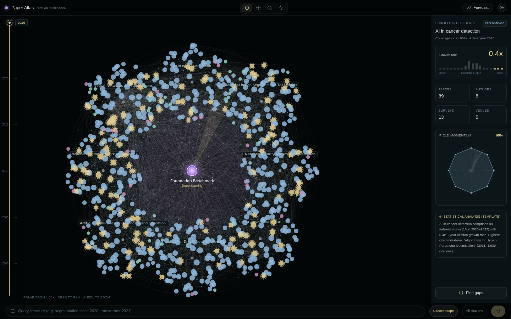

# Paper Atlas · Citation Intelligence

> **Repository:** `0999aaz/CiteOrbit` · **Application Name:** Paper Atlas  
> Design Engineer Portfolio Project: Polar Academic Citation Topology built with React, TypeScript (strict), Zustand, and a stateless HTML5 Canvas 2D renderer.



---

## 1. Engineering Trade-offs (工程决策与取舍)

| 决策 (Decision) | 选择 (Choice) | 原因 (Rationale) | 代价 (Cost / Trade-off) |
|---|---|---|---|
| **渲染管线** | 原生 HTML5 Canvas 2D + 复合路径批处理 | 避免 778 节点 + 3,612 连线在 DOM/SVG 下的重排与 GC 抖动；按样式桶合并二次贝塞尔曲线后每帧仅 `≤ 6` 次 `ctx.stroke()`，单帧渲染耗时中位数 `2.20 ms`（均值 `2.55 ms`） | 失去原生 DOM 节点级无障碍焦点与 CSS 样式，需自行维护屏幕↔世界逆变换与动态坐标拾取 |
| **动画与拾取同步** | 单一真相纯函数 (`src/layout/positions.ts`) | 簇中心浮动、选中簇 `1.18×` 外扩、簇内节点 `1.12×` 展开及轨道微摆全部由 `computeNodePositions()` 统一产出，`renderer.ts` 与 `hitTest.ts` 共享同一时间截面 `timeSec` | 每帧及每次指针命中需一次 `O(N)` 极坐标三角计算（通过复用 `RenderScratch` Map 实现零 GC 分配） |
| **数据获取方式** | OpenAlex REST API 离线抓取快照 (`graph.json`) | 纯静态部署零运行时网络请求，规避公共 API 限流与首屏等待；`0.65 MB` 快照包含真实论文、综述、作者与期刊拓扑 | 数据非实时流式更新，补充最新文献需在本地重跑 `npm run fetch-data` |
| **状态与高频交互解耦** | Zustand 仅管低频 UI 状态 + `useRef` 承载相机交互 | 滚轮缩放与拖拽平移直接读写 `cameraRef` 并通过 DOM `ref` 更新缩放倍率文本，每帧至多节流同步一次，彻底消除 60Hz React 重渲染 | 需要通过 `useDashboard.subscribe` 处理外部相机重置（如切换子领域自动归位）的双向同步 |
| **智能分析与检索** | 确定性统计模板 + 词法/时间/P90 检索（可选离线 Gemini 增强） | 纯静态站点不暴露任何 API Key，保证离线可复现且零幻觉；查询栏基于真实标题、子领域、年份区间与 P90 被引阈值实时过滤 | 默认摘要为结构化统计模板而非自由对话式 LLM 推理 |

---

## 2. 验收状态矩阵 (Honest Acceptance Status)

| 验收项 | 状态 | 实际工程实现说明 |
|---|---|---|
| **OpenAlex 真实数据管线** | ✅ 已达成 | `npm run fetch-data` 分页拉取 6,000 篇候选文献（2015–2026 近期文献 + 1995–2014 高被引奠基文献），经去重、语料内入度打分裁剪产出 `778` 个节点（`569` 论文、`144` 综述、`40` 作者、`25` 期刊/会议）与 `3,612` 条边（`0.65 MB`）。 |
| **实体统计诚实性** | ✅ 已达成 | 作者与期刊节点的 `paperCount`、`citationSum`、`year` 全部由 `graph.nodes` 真实聚合得出（零硬编码年份、零 `×100 / ×150` 虚构乘数）；右侧 2×2 指标卡直接统计去重节点数。 |
| **动画渲染与命中拾取一致** | ✅ 已达成 | `renderer.ts` 与 `hitTest.ts` 共享 `computeClusterAnchors` / `computeNodePositions` 及最近一帧 `lastFrameTimeRef`，在任意运行时间与 `0.4×–4.0×` 缩放下拾取零偏移。 |
| **非被动滚轮与鼠标锚点缩放** | ✅ 已达成 | 通过原生 `{ passive: false }` 监听器绑定 `wheel` 事件（零控制台告警），连续缩放到 `3.0×` 光标锚点世界坐标漂移 `< 0.5px`。 |
| **时间轴节流联动与记忆化** | ✅ 已达成 | `TimelineRail` 拖拽通过 `requestAnimationFrame` 节流更新年份，`derive.ts` 以 `WeakMap` 按 `${subfieldId}\|${year}` 缓存派生指标，`IntelPanel` 与 `RadarWidget` 实时同步。 |
| **簇内结构与时间空白检测** | ✅ 已达成 | 点击 `Find gaps` 真实计算三类信号：(a) 簇内 `cites` 入度为 0 的高权重孤立论文 Top 5；(b) 近 10 年零产出断档年份；(c) 低于簇年均产出 30% 的稀疏 3 年滑动窗口。 |
| **底部检索栏多维过滤** | ✅ 已达成 | `CommandBar` 解析关键词、`since YYYY`、`last N years`、裸年份 `YYYY`，结合 `Cluster / Global` 范围与 `P90 Milestone` 阈值返回真实 Top 3 论文并支持点击定位。 |
| **多级细节 (LOD) 平滑过渡** | ✅ 已达成 | `lod.ts` 提供平滑线性插值，随缩放渐进显隐微节点、论文标题与被引数标签。 |
| **渲染性能可量化** | ✅ 已达成 | 内置 `FpsMeter`（按 `F` 键或顶部第 4 个工具图标切换），单帧 Canvas 2D 绘制中位数 `2.20 ms`（P95 `4.00 ms`），远低于 60 FPS 的 `16.67 ms` 帧预算。 |
| **AI 研判能力边界** | ⚠️ 部分达成 | 默认使用确定性统计模板生成摘要（面板明确标注 `Statistical analysis (template)`），无浏览器端实时 LLM 调用；提供 `scripts/enrich-gemini.ts` 支持在配置 `GEMINI_API_KEY` 时离线生成摘要。 |
| **Forecast 未来推演** | ⚠️ 部分达成 | `Forecast` 模式为基于当前 3 年增长率与覆盖率指数的 5 年启发式外推（明确标注 `Trajectory projection (heuristic)`），非计量经济学或机器学习预测模型。 |
| **3D 地球 / WebGL 视图** | ❌ 未做 | 仅实现 2D 极坐标 Canvas 视图；`renderer.ts` 保持纯函数签名以便未来替换渲染后端，但当前未实现可旋转 3D 球体模式。 |

---

## 3. Synthetic vs Real Data (真实数据与派生指标边界)

为了避免学术可视化作品集中常见的“假数据包装”，本项目严格区分 **OpenAlex 原始字段** 与 **项目自定义派生指标**：

### 3.1 100% 来自 OpenAlex REST API 的真实字段
- **根节点 (`graph.root`)**: 语料库内被引最高的奠基文献（如 LeCun, Bengio & Hinton 2015 *"Deep learning"*, OpenAlex ID `W2963403868`）的真实标题、年份与被引次数。
- **论文与综述节点 (`paper` / `review`)**: OpenAlex Work ID、真实论文标题 (`label`)、发表年份 (`year`)、全局被引次数 (`weight` / `citationSum`)、OpenAlex `primary_topic.subfield` 归属。
- **作者与期刊节点 (`author` / `venue`)**: 从入选论文的 `authorships` 与 `primary_location.source` 聚合得出，`paperCount` 为该实体在当前快照语料中的真实入选篇数（门槛 `≥ 2`），`citationSum` 为对应入选论文被引数之和，`year` 为其在语料中的最新发表年份。
- **拓扑连线 (`cites` / `wrote` / `published_in`)**: 全部源自 OpenAlex `referenced_works` 引用关系、真实署名关系与发表载体关系。

### 3.2 项目派生的合成/启发式指标（非标准文献计量学指标）
- **`Coverage index` (`derive.ts -> coverage()`)**: 本项目构造的复合指数 `round(baseCoverage * (0.45 + 0.55 * density))`，综合子领域在快照中的归一化规模 (`baseCoverage`) 与截至选中年份的历史发表密度 (`density`)。界面已由易混淆的 `Base coverage` 更名为 `Coverage index` 并附带悬浮说明。
- **`Growth rate` (`derive.ts -> calculateGrowth()`)**: 选中年份前两个连续 3 年窗口 `[Y-2, Y]` 与 `[Y-5, Y-3]` 的语料内论文篇数比值（钳制在 `[0.4x, 3.5x]`），画布悬浮提示与右侧面板共用同一纯函数。
- **极坐标位置 (`precompute.ts` & `positions.ts`)**: 8 个子领域按环形等角排布，簇内节点按类型分层轨道（综述内圈、论文中圈、作者与期刊外圈）确定性排布并叠加正弦微浮动。
- **面板文本摘要 (`aiAnalysis`)**: 默认由 `scripts/prune.ts` 基于篇数、增长率与最高被引论文确定性拼接（`analysisSource: "template"`）；仅在本地配置 `GEMINI_API_KEY` 运行抓取脚本时由 `scripts/enrich-gemini.ts` 生成（`analysisSource: "gemini"`）。

---

## 4. Performance Methodology (性能测量方法与优化前后对比)

### 4.1 测量环境与基准协议
- **语料规模**: `778` 个节点 + `3,612` 条二次贝塞尔连线（全视口 `scale = 1.00x` 无视锥裁剪剔除）。
- **视口尺寸**: 桌面端 `1440 × 900` CSS px（主画布 `1160 × 810` CSS px，`devicePixelRatio = 1`）。
- **测量环境**: 容器内无 GPU 硬件加速的 Headless Chromium（纯 CPU 软件光栅化），采集连续 **300 帧** `renderCanvas()` 纯 CPU/Canvas 调用耗时（`performance.now()` 包裹单帧完整绘制），分别记录 `requestAnimationFrame` 节拍与同步紧循环两组分布。

### 4.2 优化前后量化对比 (`P2-1` & `P2-2`)

| 指标 (300 Frames, 778 Nodes + 3,612 Edges) | 优化前 (Before) | 优化后 (After) | 变化幅度 |
|---|---|---|---|
| **rAF 单帧绘制均值 (`mean`)** | `7.61 ms` | **`2.55 ms`** | **-66.5%** |
| **rAF 单帧绘制中位数 (`p50`)** | `7.00 ms` | **`2.20 ms`** | **-68.6%** |
| **rAF 单帧绘制 95 分位 (`p95`)** | `11.30 ms` | **`4.00 ms`** | **-64.6%**（占 `16.67 ms` 预算仅 24%） |
| **紧循环单帧中位数 (`tight p50`)** | `7.70 ms` | **`2.30 ms`** | **-70.1%** |
| **紧循环尾部尖峰 (`tight p95`)** | `170.40 ms` | **`5.20 ms`** | **-96.9%**（消除路径提交与 GC 尖峰） |
| **每帧 `ctx.stroke()` 边绘制调用数** | `~3,612 次` | **`≤ 6 次`** | **按样式桶复合 `beginPath` 批处理** |
| **每帧节点循环 `ctx.save()/restore()`** | `~778 对` | **`0 对`** | **仅在需要 `shadowBlur` 的高亮节点复位状态** |
| **拖拽/滚轮期间 React 组件重渲染** | 每次指针事件重渲染 | **`0 次`** | **`cameraRef` + DOM `zoomHudRef` + rAF 节流** |

---

## 5. Not Implemented / Known Limitations (已知局限与未实现项)

1. **无 3D 球体 / WebGL 渲染后端**: 本仓库专注于原生 HTML5 Canvas 2D 的极坐标拓扑与性能压榨，未实现可旋转 3D Globe 视图。
2. **离线静态快照与近期被引滞后 (Citation Lag)**: `src/data/graph.json` 为构建期抓取的离线快照；由于候选文献打分公式 `3 * inDegree + ln(1 + cited_by_count)` 偏好高被引与高语料内互引文献，2024–2026 年发表的新论文因学术引用累积滞后入选较少，导致时间轴停留在 `2026` 时部分成熟子领域的 3 年增长率低于 `1.0x`（将左侧时间轴回拉至 `2019–2022` 可观察到 `> 1.5x` 的爆发期）。
3. **无运行时大模型推理**: 为保证纯静态零密钥部署，浏览器端不包含实时 LLM 请求；底部检索栏为确定性多字段词法/年份/P90 过滤，非语义向量检索（RAG）。
4. **桌面端优先视口**: 小于 `768px` 宽度的竖屏移动设备展示横屏/桌面访问提示，未针对手机窄屏重排三栏数据工作台。

---

## 6. 目录结构与本地复跑

```text
scripts/
  fetch-openalex.ts        # OpenAlex REST API 分页抓取与快照生成入口
  prune.ts                 # 去重、入度打分、子领域聚类、真实实体聚合与模板摘要
  enrich-gemini.ts         # 可选的构建期 Gemini 离线摘要生成（无 Key 自动跳过）
src/
  App.tsx                  # 三栏深色工作台外壳
  styles/tokens.css        # 设计令牌（色板、字体、间距、面板尺寸）
  store/useDashboard.ts    # Zustand UI 状态（选区、年份、工具、问答记录）
  data/
    schema.ts              # 严格数据结构定义（GNode, GEdge, Subfield, Graph）
    graph.json             # OpenAlex 真实抓取产物（778 节点, 3,612 边, 0.65 MB）
    derive.ts              # 派生纯函数 + WeakMap 记忆化（coverage, calculateGrowth, forecast）
    query.ts               # 检索栏词法、年份区间与 P90 里程碑过滤引擎
    gaps.ts                # 簇内零入度高被引论文与时间断档/稀疏窗口检测
  layout/
    precompute.ts          # 静态极坐标基线预计算
    positions.ts           # 动态世界坐标单一真相源（renderer 与 hitTest 共享）
  canvas/
    GraphCanvas.tsx        # Canvas 宿主：DPR、非被动滚轮缩放、拖拽、拾取与 HUD
    camera.ts              # 缩放平移变换与鼠标锚点缩放矩阵
    renderer.ts            # 纯函数渲染器（零 React/Zustand 依赖，支持 RenderScratch 复用）
    lod.ts                 # 多级细节平滑透明度插值
    hitTest.ts             # 基于实时动画坐标的屏幕逆变换拾取
  components/
    TopBar.tsx  TimelineRail.tsx  IntelPanel.tsx
    CommandBar.tsx  RadarWidget.tsx  FpsMeter.tsx
  hooks/
    useAnimationFrame.ts  useResizeObserver.ts
  utils/
    typewriter.ts          # 防抖与公共前缀续打的确定性打字机步进逻辑
```

```bash
# 1. 安装依赖
npm install

# 2. 运行严格类型检查与全部单元测试（23 项断言）
npm run lint
npm test

# 3. 启动本地开发服务器 (http://localhost:3000)
npm run dev

# 4. 生产构建验证
npm run build

# 5. （可选）从 OpenAlex 重新抓取真实文献并重建 src/data/graph.json
npm run fetch-data
```

## License

MIT © 0999aaz
